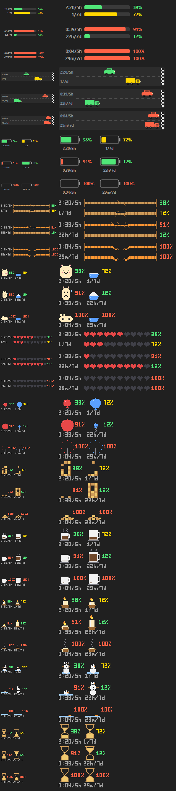

# Claude Code Usage Taskbar Widget

*[한국어 README](README.ko.md)*

Shows how much of your Claude Code subscription limits (5-hour window · weekly window) you have burned, **pinned to the Windows 11 taskbar**. A single PowerShell script — nothing to install.



```
2:21/5h ████████░░░░░░░░ 38%      ← 5-hour window: 2h 21m until reset, 38% used
   4/7d ██████████████░░ 72%      ← weekly window: 4 days until reset, 72% used
```

> **Heads-up for non-Korean speakers:** the widget's own UI — right-click menu, theme names, error labels — is currently **Korean only**. The tables below tell you what each menu item says. Everything else (numbers, gauges, artwork) is language-neutral. PRs adding UI localization are welcome.

## Let an AI install it (easiest)

Paste this into Claude Code, or any other AI coding tool that can run a shell:

```
Read the README at https://github.com/HengSsg/ai-usage-theme and install the Claude Code usage widget by following it.
Clone it into %USERPROFILE%\tools\cc-usage-tray, run setup.ps1, then check the taskbar and tell me whether the widget is showing.
If you see "로그인 정보가 없습니다" (no login credentials), tell me I need to log into claude and wait for me.
```

Updating is one line too:

```
Update the Claude Code usage widget in %USERPROFILE%\tools\cc-usage-tray to the latest version (git pull, then re-run setup.ps1).
```

<details>
<summary>Procedure for AI agents (humans can skip this)</summary>

```
# Install — run in order, then confirm the last output contains "설치 완료" (installation complete)
git clone https://github.com/HengSsg/ai-usage-theme.git "%USERPROFILE%\tools\cc-usage-tray"
powershell -NoProfile -ExecutionPolicy Bypass -File "%USERPROFILE%\tools\cc-usage-tray\setup.ps1"

# If the output says "Claude Code 로그인 정보가 없습니다": ask the user to run `claude` and log in with a subscription account, then re-run setup.ps1 only
# If the folder already exists (reinstall/update): git -C "%USERPROFILE%\tools\cc-usage-tray" pull --ff-only  ->  re-run setup.ps1
# Verify: a "H:MM/5h ... N/7d ..." widget on the left of the taskbar (icons centered) or just before the tray (icons left-aligned). Process: powershell.exe running usage-tray.ps1
# Uninstall: powershell -NoProfile -ExecutionPolicy Bypass -File "%USERPROFILE%\tools\cc-usage-tray\setup.ps1" -Uninstall
```

Prerequisites: Windows 11 · a Claude Code subscription (Pro/Max/Team) logged in via OAuth · git. Nothing else to install. The only network access is `api.anthropic.com` (usage) and `github.com` (install/update).
</details>

## Requirements

- Windows 11 (built against a 48px taskbar at 100% scaling) · PowerShell 5.1 (ships with Windows)
- **Logged into Claude Code** — `%USERPROFILE%\.claude\.credentials.json` must exist.
  Subscription (Pro/Max/Team) OAuth login only — API-key logins have no usage API.

## Install / uninstall

1. Get it, either way:
   ```
   git clone https://github.com/HengSsg/ai-usage-theme.git %USERPROFILE%\tools\cc-usage-tray
   ```
   or **Code → Download ZIP** on GitHub and unpack it wherever you like. (With `git clone` you can later update via `git pull`.)
2. **Double-click `install.cmd`** → registers a startup entry and launches the widget immediately
3. Uninstall: **`uninstall.cmd`** (stops the widget · removes the startup entry and watchdog task · deletes your local settings)

Moving the folder breaks the startup shortcut — re-run `install.cmd` after moving it.

## Using it

**Right-click** the widget:

| Menu (Korean) | What it does |
|---|---|
| 테마 — *Theme* | 12 themes, listed below. Hovering an entry shows a one-line description |
| 위치 — *Position* | Auto (left when taskbar icons are centered, before the tray when they are left-aligned) · Left · Right |
| 지금 새로고침 — *Refresh now* | Re-query immediately |
| 업데이트 확인 — *Check for updates* | Checks GitHub for a newer version → installs it and restarts (see [Updates](#updates)) |
| 종료 — *Exit* | Closes the widget (it comes back at next logon — use `uninstall.cmd` to remove it for good) |

Hover the widget for a tooltip with the exact time until each reset.

- Labels: `2:21/5h` = 2h 21m until the 5-hour window resets · `4/7d` = 4 days until the weekly window resets (under 24 hours it shows `23h/7d`)
- Colors: green below 60% used · yellow below 85% · red above
- Status text: `CC 잠시 후 재시도` = API 429, recovers on its own · `CC 재로그인 필요` = token expired, run `claude` and log in again · `CC 조회 실패` = network/proxy problem, tooltip has the raw error

## Themes

01–03 and 13 are vector-drawn; the rest are **2px dot pixel art** (48px tall = 24 rows). How each theme splits the two numbers:

| # | Theme | How it reads | 5h / 7d |
|---|---|---|---|
| 01 | Bar gauge (default) | Progress bars + numbers | Two rows |
| 02 | Cars | **Animated** — lane markings scroll, wheels spin, the body bounces (smoother while hovered). Position = usage | Car / truck |
| 03 | Battery | Charge left = limit left | Two cells |
| 04 | Rope | Frays as you burn through → one strand at 75% → **snaps at 100%** | Thin rope / thick rope |
| 05 | Full belly | Belly size and expression = 5h left, rice bowl = 7d left. Passes out at 100% | Character / bowl |
| 06 | Heart HP | 10 hearts, one empties every 10% | Two rows |
| 07 | Balloon | Inflates as you burn through, **pops at 100%** | Red / blue |
| 09 | Coffee | Coffee in the cup = limit left; steams when full | Small cup / mug |
| 10 | Candle | Wax left = limit left, flame flickers, smoke once burnt out | 5h on top / 7d below |
| 11 | Snowman | Melts into a puddle; at 100% only the hat and carrot are left | 5h on top / 7d below |
| 12 | Hourglass | Sand on top = limit left, grains falling through the neck | 5h on top / 7d below |
| 13 | Panda and bamboo | Both numbers in **one scene** — cut from the grove, stack it in front of the panda, then eat it. **It chews** | Shoot pile in front / bamboo grove behind |

Numbers are just menu ordering (08 was a Jenga theme, dropped — a vertical metaphor doesn't fit a 48px-tall horizontal widget).

> **Theme layout tips** — cramming icon, percentage and label into one cell of a 48px strip makes an unreadable clump.
> `label (right-aligned) | icon | %` as **two column-aligned rows** (5h on top, 7d below) reads best — bars, rope, hearts, coffee and candle all use it.
> Gauges that fill vertically only have 6–8 steps of resolution, so leave the exact value to the number beside them and let the picture say roughly how much is left.
> Blinking effects (flame, steam, falling sand) change once a minute — matched to the widget's per-minute redraw.
> On a light-theme taskbar the text and gauge colors automatically shift darker.

## Updates

When a theme is added or a fix lands, the widget tells you and can update itself.

- **Automatic check**: once 20 seconds after startup, then once a day. If a newer version exists, a **yellow dot** appears in the widget's top-right corner and "새 버전 있음" (new version available) shows in the tooltip and menu. It does not install anything on its own.
- **Installing**: right-click → **업데이트 설치** (install update) → confirm → downloads, overwrites, **restarts automatically**. `config.json` (theme, position) and `last.json` are preserved.
- The method is picked from how you installed: `git pull --ff-only` for a `git clone`, or re-downloading GitHub's `main.zip` for a ZIP install (whose current version is tracked in `version.txt`).
- Manually: `git pull`, then `install.cmd` (which includes the restart).

## How it works

- Polls `GET https://api.anthropic.com/api/oauth/usage` — the endpoint Claude Code's own `/usage` uses — **every 120 seconds**.
  It is an undocumented endpoint, so Anthropic can break it at any time. The token is read from `.credentials.json` on every call, so it follows Claude Code's own token refresh (no refresh logic of its own).
- Windows 11 has no official API for putting a widget into the taskbar, so this lays a **TOPMOST window over it**. Position and z-order are re-asserted every 2 seconds, and the background color is sampled from taskbar pixels to match the light/dark theme. If the taskbar auto-hides, the widget hides with it.
- Every network call is **async**. Waiting for a response on the UI thread stalls the message loop and Windows kills the process as "not responding" (early versions vanished this way). Requests are now fired off, and a 1-second tick only checks whether they finished.
- 429 avoidance: single instance (mutex) · last response cached in `last.json` (no re-fetch right after a restart) · polling interval doubles on failure, up to 10 minutes.
- Errors are never swallowed silently — they go to `error.log` (truncated past 20KB). If the widget disappears or misbehaves, read that file first.

## Reliability

The widget used to **die after the screensaver had been on for a while**. The cause was not a crash but a **hang** — on a locked (secure) desktop, screen capture and GDI calls block, the UI thread stops, and Windows terminates the process as not responding (event log: `Application Hang`).

Three layers guard against it:

| Layer | What it does |
|---|---|
| **Prevention** | While the screensaver is running or the session is locked, it does not touch the screen at all (capture, render and animation stop). Lock detection uses `OpenInputDesktop` plus screensaver state. |
| **Self-recovery** | A background watchdog monitors a UI-thread heartbeat. If it stops for more than **25 seconds**, it writes the **stalled stage** to `error.log`, spawns a new instance and kills itself immediately. No admin rights needed. |
| **External watcher** | A scheduled task (at logon + every 5 minutes, skipped if already running) covers the case where the process disappears entirely. **No admin rights needed** — as long as the logon trigger has `-User` and `-RepetitionDuration` is omitted (see below). |

Beyond that: unhandled exceptions are caught and logged to `error.log` so the widget stays alive, and every background thread wraps its exceptions so they can't take the process down.

⚠️ **Don't assume a failing scheduled-task registration is an admin-rights problem** (measured 2026-09-14 — that was exactly the wrong diagnosis). It registers fine as a normal user. Failures are almost always one of these two:

- `New-ScheduledTaskTrigger -AtLogOn` **without `-User`** becomes an "any user" trigger and gets `Access is denied`
- `-RepetitionDuration ([TimeSpan]::MaxValue)` serializes to `P99999999DT23H59M59S`, **invalid XML**, and is rejected — **omitting it is what means "repeat indefinitely"**

⚠️ The watchdog must not use `Environment.Exit` to end itself. Running exit handlers and finalizers makes it **freeze alongside the stuck UI thread**, so the new instance can't take the mutex, backs off, and **nothing is left running** (measured: stalled at 12:11, no widget for 85 minutes until Windows terminated it at 12:38). `Process.GetCurrentProcess().Kill()` dies immediately and releases the mutex.

⚠️ Right-click **종료** (exit) leaves a `stopped.flag` so the watcher doesn't resurrect it. Run `install.cmd` to bring it back (it survives reboots).

## Writing a theme

A `themes\NN-name.ps1` file registers itself in the menu if its **last expression returns** this hashtable (the two-digit prefix is the menu order).

```powershell
@{
    Id = 'myTheme'; Name = 'My theme'; Width = 200     # Width is an int, or { param($d) ... }
    Desc = 'One-line description - shown when hovering the entry in the theme menu'
    Draw = {
        param($g, $d, $w, $h)                          # $g = System.Drawing.Graphics, canvas is $w x $h
        Draw-Text $g $d.L5 11 $true $Col.Label 8 15    # 5h label (e.g. 2:21/5h)
        Fill-RoundRect $g $d.C5 40 11 100 9 2          # $d.S5 = 5h usage (%), $d.C5 = its color
    }
}
```

`$d`: `S5` `S7` (usage %) · `C5` `C7` `CD` (colors; `CD` is the higher of the two) · `L5` `L7` (time-left/window labels) · `R5` `R7` (reset text).
Helpers: `Draw-Text` (vertically centered) · `Fill-RoundRect` · `Draw-RoundRect` · `Fill-Circle` · `Fill-Ellipse` (top-left origin) · `Measure-Text` · `$Col` (Green/Gold/Red/Track/Label/Dim/Light/Road) · `Get-LevelColor`.

**Pixel-art themes** start with `Use-PixelMode $g` and use the cell (2px) helpers — the canvas is 24 rows × (width/2) columns:

```powershell
Use-PixelMode $g                                  # anti-aliasing off
Px-Fill $g $Px.Cream 3 5 10 4                     # (x, y, w, h) in cells
Px-Circle $g $Px.White 9 14 3                     # (cx, cy, r)
Draw-Sprite $g @('.##.', '####', '.##.') 2 2 @{ '#' = $Px.Red }   # one string = one row, char -> color, '.' transparent
Draw-PixelText $g $d.L5 0 18 $Col.Label           # 3x5 pixel font (digits : / % h d m)
```

`$Px` palette: Ink White Gray Dark Red Pink Orange Yellow Green Blue Sky Brown Wood Cream Sand Coffee. For per-minute effects use `(Get-Date).Minute % 2`.

**Animated themes** declare `Anim = 120` (frame interval in ms) to be redrawn on that cycle, with `$d.F` as the frame number. Animation stops automatically while hidden.

**Hover boost** — a theme runs at its declared interval only while the mouse is over the widget, and `$AnimIdleX` times slower otherwise (4x by default). Smooth when you look at it, cheap when you don't. The values live near the top of `usage-tray.ps1`.

⚠️ Animation costs more than you'd guess. Measured:

| | CPU (one core) |
|---|---|
| Redrawing vectors every frame (8fps) | 8% — `Fill-RoundRect` builds a GraphicsPath on every call |
| Pre-baking the static background and 4 car frames, then blitting | 3% (1.2ms/frame) |
| + hover boost (480ms when idle) | **1.3%** — about the same as a static theme (~1%) |

The expensive part is the vector redraw, not `DrawImage` (0.04ms); what's left is window recomposition. Shortening the frame interval alone barely moves it — the fixed cost dominates.

**Absolute numbers shift with overall machine load, so only compare measurements taken in the same sitting.** From one session: static theme 1.6% · cars 4.9% · panda 4.0%. Panda uses the same trick as cars (bake 4 finished frames, blit one per frame) — drawing it as vectors every frame is far more expensive under the same conditions.

Check your theme without hitting the API:

```
powershell -ExecutionPolicy Bypass -File usage-tray.ps1 -RenderTest out.png
```

You get a single PNG with every theme rendered at 1x and 2x against two sets of sample data.

## Known limitations

- The widget's UI text is Korean only (see the note at the top)
- It draws over fullscreen apps (games, video)
- On a vertical (left/right) taskbar the horizontal layout doesn't fit, so the widget hides itself
- Untested at scaling other than 100%

## Files

| File | Role |
|---|---|
| `usage-tray.ps1` | The widget |
| `themes\*.ps1` | Theme plugins |
| `setup.ps1` · `install.cmd` · `uninstall.cmd` | Install / uninstall |
| `config.json` · `last.json` · `version.txt` | Local settings, cache, installed version (auto-generated, not shared) |
| `design\` | Theme mockup generator (optional) |

## License

[MIT](LICENSE)
